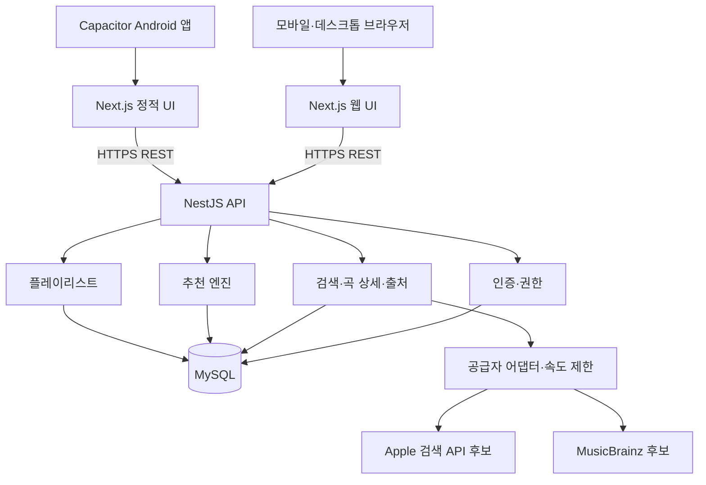

# 아키텍처 초안

상태: 승인된 MVP 구현. 실제 Apple 검색·일부 MusicBrainz 곡 단위 장르 연결, 웹 통합 흐름 및 Android AAB/lint 검증 진행. 최신 결과는 [검증 기록](VALIDATION.md)을 따른다.

## 경계와 배치

- `apps/web`: Next.js 화면, 검색·필터·플레이리스트 상태, API 클라이언트. 비밀정보와 추천 판정 로직을 넣지 않는다.
- `apps/api`: NestJS의 `auth`, `catalog`, `providers`, `taxonomy`, `recommendations`, `playlists`, `health` 모듈.
- 초기 구현은 이 경계를 서비스·파일로 나누고 하나의 `AppModule`에서 조립한다. 규모가 커지면 Nest 모듈을 독립시킨다.
- `packages/contracts`: 공개 요청·응답 스키마와 타입. Prisma 내부 모델이나 비밀번호 필드를 그대로 공개하지 않는다.
- MySQL: 계정, 정규화한 곡·태그·출처, 플레이리스트, 세션 해시 저장. 초기에는 Redis·벡터 DB·메시지 큐를 추가하지 않는다.
- 웹과 Android가 같은 API를 사용한다. Android는 기기에서 도달 가능한 HTTPS API 주소가 필요하며 개발 PC의 localhost 주소를 그대로 쓰지 않는다.

## 검색·장르 설명 흐름

1. API가 검색어 길이와 문자 입력을 검증한다.
2. 검색 공급자를 호출하거나 허용된 기간 안의 캐시를 조회한다. 사용자 입력을 임의의 외부 URL로 변환하지 않는다.
3. 외부 식별자로 곡을 정규화한다. 공급자 간 연결은 ISRC 우선, 메타데이터 보조 매칭으로 하며 모호하면 합치지 않는다.
4. 곡·앨범·아티스트 태그를 적용 범위와 함께 보존한다. 장르 taxonomy의 별칭은 검증된 것만 병합한다.
5. 프런트에 태그, 출처, 적용 범위, 확인 시점, `confirmed / indicative / unknown` 근거 상태를 전달한다. 이것은 통계적인 정확도 확률이 아니다.
6. UI가 확정 설명·관련 정보·정보 부족을 구분한다. 아티스트·앨범 태그를 곡의 확정 장르로 승격하지 않는다.

외부 서비스가 실패하면 원인을 분류한 오류나 명시적인 오래된 캐시 상태를 반환한다. 샘플 데이터로 조용히 대체하지 않는다. 보관 가능 데이터·TTL·출처 표시는 공급자 조건 검토 후 확정한다. API 응답 원문 전체를 무조건 저장하지 않는다.

실제 검색에서 KR 시장은 대표 국내·해외 검색 모두 0곡을 반환했고 US 시장은 결과를 반환했다. `APPLE_COUNTRY=US`를 기본으로 하며 공급자 시장을 곡 ID와 출처 식별자에 포함한다. UI 언어나 사용자의 국적을 미국으로 간주하는 설정이 아니다. 외부 검색은 분당 약 20회 이내가 되도록 간격을 두고, 60초 요청 병합·최대 50개 검색 캐시·대기 요청 상한을 둔다.

현재 기본 모드는 `live`다. `catalog:sync`가 소규모 대표곡 메타데이터를 가져오며, 빈 검색은 저장된 현재 모드 카탈로그를 표시한다. `demo`는 가상 곡으로 테스트하는 별도 모드다. 실제 곡의 분위기 태그는 아직 확보하지 않았으므로 임의로 채우지 않는다.

## 추천 로직 v1

- 후보: 검증된 카탈로그에서 장르 또는 분위기 태그를 공유하는 곡. 외부 공급자의 검색 기능 범위와 조건에 맞춰 카탈로그를 보강한다. 무차별 스크래핑하지 않는다.
- 장르 유사도 `G`, 분위기 유사도 `M`은 각각 태그 집합의 Jaccard 유사도(교집합 / 합집합)로 시작한다. 빈 합집합은 0이다.
- 기본 점수는 `0.65 × G + 0.35 × M`. '장르 중심'은 G, '분위기 중심'은 M으로 정렬한다. 가중치는 초기 제안으로 품질 검증 후 조정한다.
- 없는 태그는 0으로 처리하고 데이터 보유 상태를 함께 표시한다. 근거가 부족한 곡을 점수 재정규화만으로 높은 품질의 추천처럼 표시하지 않는다.
- 곡 단위 또는 직접 검수한 태그를 기본 추천 근거로 사용한다. 아티스트·앨범 단위 정보는 별도 관련 정보로 표시한다.
- 원곡 제외, 공급자 중복 병합, 곡 ID에 의한 안정적인 동점 정렬, 결과 개수 상한을 적용한다. 같은 아티스트가 결과를 독점하지 않도록 제한한다.
- 겹치는 태그가 없거나 후보가 부족하면 그 사실을 표시한다. 후보를 무작위로 채워 '비슷한 곡'이라고 부르지 않는다.
- 추천 응답은 점수, 겹친 태그, 근거 수준, 추천 이유를 포함한다. 수치 자체를 장르 정확도나 AI 분석 확률로 설명하지 않는다.

## API 초안

| 메서드·경로                                                                    | 용도                                               |
| ------------------------------------------------------------------------------ | -------------------------------------------------- |
| `GET /v1/health/live`, `GET /v1/health/ready`                                  | 프로세스·DB readiness 분리                         |
| `GET /v1/search/tracks?q=...&cursor=...`                                       | 곡 검색, 페이지 크기 상한                          |
| `GET /v1/tracks/:id`                                                           | 정규화한 곡, 태그·출처                             |
| `GET /v1/tracks/:id/recommendations?mode=balanced`                             | 장르·분위기·균형 모드 추천                         |
| `POST /v1/auth/register`, `/login`, `/refresh`, `/logout`                      | 계정·세션 관리                                     |
| `GET /v1/auth/me`                                                              | 현재 계정                                          |
| `GET /v1/playlists`, `POST /v1/playlists`                                      | 내 플레이리스트 목록·생성                          |
| `GET /v1/playlists/:id`, `PATCH /v1/playlists/:id`, `DELETE /v1/playlists/:id` | 소유자 조회·수정·삭제                              |
| `POST /v1/playlists/:id/tracks`, `DELETE /v1/playlists/:id/tracks/:trackId`    | 곡 추가·제거                                       |
| `PUT /v1/playlists/:id/order`                                                  | 전체 곡 ID 순서 + playlist version으로 원자적 정렬 |

응답 오류는 코드·사용자용 설명·요청 ID로 통일하며 스택·외부 자격증명은 노출하지 않는다. 정렬 요청이 오래된 버전을 사용하면 `409 Conflict`, 중복 곡 추가는 명시적인 충돌 응답으로 처리한다.

## 인증·운영

- 비밀번호는 Argon2id 등 검증된 비밀번호 해시로 보관한다. 로그인·가입·외부 검색에는 속도 제한을 둔다.
- 짧은 수명의 access token과 회전 가능한 refresh session을 제안한다. DB에는 refresh token 원문 대신 해시를 저장하고 로그아웃 시 폐기한다.
- 웹은 access token을 메모리에, refresh token을 `HttpOnly`, `Secure` 쿠키에 둔다. 동일 사이트 도메인 구성과 허용 origin, CSRF 방어를 함께 설계한다.
- Android는 브라우저 쿠키 정책과 다르므로 초기 검증에서 인증 경로를 확정한다. 네이티브 장기 토큰은 Android Keystore를 사용하는 검증된 보관 방식으로 처리한다. localStorage를 장기 토큰 저장소로 삼지 않는다.
- 서버가 매 플레이리스트 요청에서 소유권을 확인한다. CORS는 확인된 웹·앱 origin만 허용한다. 쿠키 사용 시 와일드카드 origin을 허용하지 않는다.
- 비밀값은 서버 환경변수·환경 설정에서만 받는다. `NEXT_PUBLIC_` 변수에는 공개 API 주소 등 공개 가능한 값만 둔다.
- `/health/ready`의 성공과 별도로 실제 검색·플레이리스트 요청으로 기능을 검증한다. 재시작 후에도 MySQL 볼륨에 데이터가 남는지 확인한다.

## Android와 출시

1. Next.js 정적 출력은 API 호출 중심 UI로 구성한다. 동적 곡 상세는 정적 출력에 맞는 경로 전략을 선행 검증에서 선택한다. 서버 전용 기능이 필요한 경우 웹/앱 분리를 재설계한다.
2. Capacitor Android 프로젝트가 정적 자산을 포함하도록 구성한다. HTTPS API, 앱 origin, 키보드, 뒤로가기, 인증 수명 주기를 검증한다.
3. Android SDK/JDK/Gradle 호환성, application ID, target SDK, 서명, AAB 생성과 기기 테스트를 확인한다. 실제 버전 정책은 출시 시 공식 문서로 재확인한다.
4. Play Console 계정·서명키·개인정보처리방침·데이터 보안 양식·계정 삭제 경로·콘텐츠 권리와 필요한 심사/테스트를 준비한다. 서명키는 저장소에 보관하지 않는다.
5. 스토어 업로드와 공개는 사용자가 별도로 승인한 뒤 진행한다. 웹 동작이나 AAB 생성만으로 Play 심사 통과를 보장하지 않는다.
