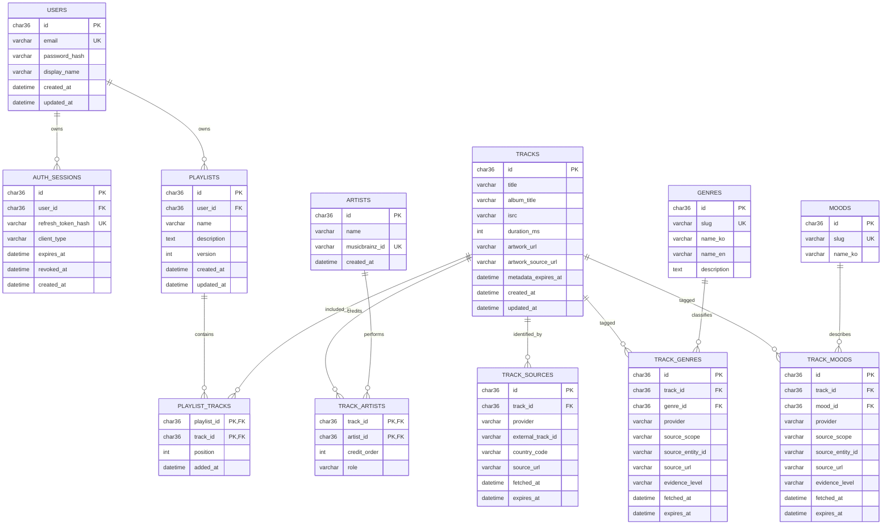

# ERD 초안

상태: 승인된 논리 모델을 MySQL 8.4 / utf8mb4에 구현했다. 실제 필드·제약은 [Prisma 스키마](../apps/api/prisma/schema.prisma)와 [초기 SQL](../apps/api/prisma/migrations/202610210001_initial/migration.sql)을 따른다. SQL 적용 이력용 `_gyeol_migrations`는 운영 테이블로 별도 관리한다.

## 식별·제약·인덱스

- 내부 ID는 UUID를 사용한다. `email`은 정규화 후 유일성 검증한다. 길이·입력 범위와 collation은 마이그레이션에서 명시한다.
- 아티스트 이름은 유일하지 않다. MusicBrainz ID가 없는 아티스트를 이름만으로 강제 병합하지 않는다.
- `TRACK_SOURCES(provider, external_track_id, country_code)`는 복합 유일 키다. country는 공급자가 시장을 구분하지 않으면 고정 sentinel로 정규화해 NULL 유일성 함정을 피한다.
- ISRC는 버전·발매 중복과 공급자 오류가 있으므로 검색 인덱스를 두고, 전역 유일 키로 단정하지 않는다.
- `TRACK_ARTISTS`의 복합 PK로 동일 곡·아티스트 중복을 막는다. 참여 역할과 표시 순서를 보관한다.
- 장르·분위기 evidence는 `(track_id, taxonomy_id, provider, source_scope, source_entity_id)`를 유일하게 한다. `taxonomy_id`는 각각 `genre_id` 또는 `mood_id`다. 검수 데이터도 내부 출처 ID와 근거를 남긴다.
- 태그 검색에는 `(genre_id, track_id)` 및 `(mood_id, track_id)`, 플레이리스트 목록에는 `(user_id, updated_at)`, 세션에는 `(user_id, expires_at)` 인덱스를 둔다.
- `PLAYLIST_TRACKS`는 `(playlist_id, track_id)`로 중복 추가를 막고 `(playlist_id, position)`도 유일하게 한다. `position`은 0 이상의 연속 정수로 유지한다.
- 순서 변경은 트랜잭션과 플레이리스트 `version` 비교를 사용한다. MySQL의 즉시 유일성 검사에서 충돌하지 않도록 임시 오프셋 등 검증된 재배치 절차를 사용하고 동시 편집을 테스트한다.
- 소유권은 API가 세션의 사용자 ID와 `PLAYLISTS.user_id`를 비교한다. URL의 ID를 아는 것으로 접근을 허용하지 않는다.

## 출처·수명·삭제 정책

- `source_scope`는 `recording / album / artist / curated`를 구분한다. `evidence_level`은 검증 기준에 따른 범주이며 확률 수치가 아니다.
- 동일 곡의 여러 장르·분위기와 여러 출처를 함께 보관한다. 만료된 근거는 갱신하거나 UI에 상태를 표시한다. 출처가 없으면 확정 설명을 만들지 않는다.
- 앨범은 초기에는 `album_title` 메타데이터로만 보관한다. 앨범 자체 편집·탐색 요구가 생기면 별도 모델로 확장한다.
- 이미지 URL·메타데이터 보관은 공급자 이용 조건이 허용하는 범위에 한한다. 앨범 커버 파일을 무조건 다운로드·재배포하지 않는다.
- Apple 커버는 `artwork_url`과 `artwork_source_url`에 공급자 이미지 주소와 해당 곡의 스토어 링크를 저장한다. `metadata_expires_at`(현재 로컬 갱신 간격 24시간)이 지나면 API 응답에서 커버를 제외한다. 파일 저장·프록시 다운로드는 하지 않으며, 만료가 DB 행 삭제를 의미하지는 않는다. 커버 표시 영역에는 공식 스토어 배지와 링크를 함께 제공한다.
- 사용자 삭제 시 세션과 개인 플레이리스트를 삭제한다. 플레이리스트 삭제 시 연결 행을 삭제한다. 공유 카탈로그 곡·아티스트는 계정 삭제로 지우지 않는다.
- 카탈로그 정리 시 플레이리스트에 연결된 곡의 FK를 보존한다. 공급자 삭제·권리 요청에는 이미지·출처 데이터를 제거하거나 제한하는 운영 정책이 필요하다.
- 추천 결과는 초기에는 계산 응답으로 제공한다. 개인 청취 이력·추천 로그 테이블은 추가하지 않는다.
